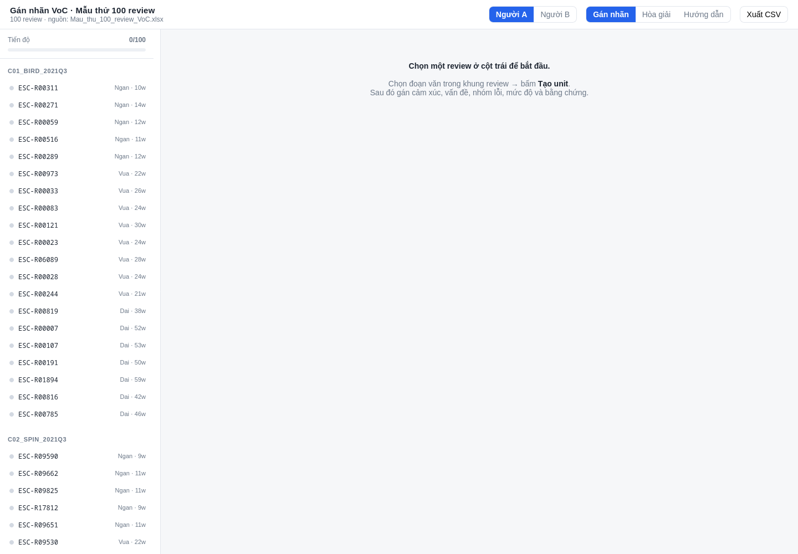
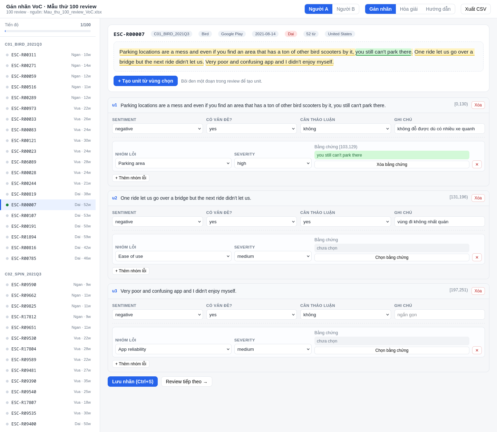

# VoC Labeling — Web gán nhãn dữ liệu Voice-of-Customer

Công cụ gán nhãn thủ công cho **100 review mẫu** (MOBI-Qual, e-scooter, Q3/2021), phục vụ xây gold set cho pipeline VoC 8 bước.

Hai người gán nhãn độc lập (A/B) → hòa giải → xuất CSV đúng schema `GanNhan`.

---

## Cài đặt & chạy

```bash
python3 -m venv .venv
.venv/bin/pip install -r requirements.txt

cd web
./run.sh                 # mặc định http://127.0.0.1:8765
# hoặc: PORT=9000 ./run.sh
```

Lần chạy đầu tự nạp 100 review từ `Mau_thu_100_review_VoC.xlsx` vào `web/data/labeling.db`.

Nạp lại từ đầu:

```bash
cd web && ../.venv/bin/python ingest.py
```

---

## Tài khoản & phân quyền

Mỗi người một tài khoản riêng. Tài khoản được **tạo tự động từ biến môi trường** ngay lần chạy đầu (và cập nhật khi bạn đổi mật khẩu).

| Biến | Vai trò | Mặc định tên đăng nhập |
|---|---|---|
| `USER_A_PASSWORD` | gán nhãn, chỉ thấy nhãn của A | `a` (đổi bằng `USER_A_NAME`) |
| `USER_B_PASSWORD` | gán nhãn, chỉ thấy nhãn của B | `b` (đổi bằng `USER_B_NAME`) |
| `USER_ADJ_PASSWORD` | hòa giải, xem được cả A và B, **không** gán nhãn | `adj` (đổi bằng `USER_ADJ_NAME`) |
| `LABEL_PASSWORD` | dự phòng: nếu không đặt 3 biến trên thì tạo 1 tài khoản `admin` | `admin` |

**Phân quyền được ép ở server**, không phụ thuộc giao diện:

- A/B gọi API với `?annotator=` khác cũng bị **ép về chính mình**.
- Tài khoản hòa giải gán nhãn → `403`.
- A/B gọi API hòa giải → `403`.
- Mỗi người **không thấy** nhãn của người kia (kiểm tra độc lập).

Mật khẩu lưu dạng PBKDF2-HMAC-SHA256 (120.000 vòng), session là cookie ký HMAC, hết hạn sau 12 giờ.

Thêm người mới về sau: thêm 1 dòng trong bảng `users` (username, password_hash, annotator) là xong — không cần sửa code.

---

## Giao diện

**Danh sách 100 review, nhóm theo case:**



**Đang gán nhãn — unit màu vàng, bằng chứng màu xanh:**



---

## Quy trình 3 vai

| Vai | Cách dùng |
|---|---|
| **Người A** | Đăng nhập tài khoản `a` → gán 100 review → Xuất CSV |
| **Người B** | Đăng nhập tài khoản `b` → gán **độc lập** (server không trả nhãn của A) |
| **Hòa giải** | Đăng nhập tài khoản `adj` → tab "Hòa giải" → xem A và B song song → chọn A hoặc B |

Vai do **tài khoản** quyết định, không còn nút chọn A/B trên giao diện. Nút chọn A/B chỉ hiện khi chạy local **không** đặt mật khẩu.

---

## Gán nhãn một review

1. Chọn review ở cột trái.
2. **Bôi đen** một đoạn trong khung review → bấm **+ Tạo unit** (hoặc `Ctrl+Enter`).
3. Chọn **Sentiment**, **Có vấn đề?**.
4. Nếu có vấn đề: thêm **Nhóm lỗi** (11 MOBI-Qual + `other`), chọn **Severity**.
5. Bấm **Chọn bằng chứng** → bôi đen đoạn văn chứng minh.
6. **Lưu nhãn** (`Ctrl+S`).

Phím tắt: `Ctrl+S` lưu · `Ctrl+Enter` tạo unit.

---

## Ánh xạ sang sheet `GanNhan`

| Cột Excel | Nguồn trong app |
|---|---|
| `Review_ID`, `Case_ID` | từ DB |
| `Nguoi_gan_nhan` | A / B / ADJ |
| `unit_id`, `unit_text_nguyen_van`, `unit_start`, `unit_end` | vùng bôi đen (offset từ 0) |
| `sentiment` | dropdown positive / neutral / negative |
| `issue_present` | dropdown yes / no |
| `category` | 11 nhóm MOBI-Qual + `other` |
| `severity` | low / medium / high / not_applicable / uncertain |
| `evidence_text`, `evidence_start`, `evidence_end` | vùng bôi đen bằng chứng |
| `Can_thao_luan`, `Ghi_chu` | ô nhập ở mức unit |

Một unit nhiều nhóm lỗi → xuất thành nhiều dòng (đúng quy ước "mỗi hàng là một unit–category").

---

## Xuất dữ liệu

| Endpoint | Nội dung |
|---|---|
| `GET /api/export.csv?annotator=A` | CSV UTF-8 (có BOM), 16 cột đúng `GanNhan` |
| `GET /api/export.csv?annotator=A&adjudicated=true` | bản đã hòa giải |
| `GET /api/export.json?annotator=A` | cùng dữ liệu dạng JSON |
| `GET /api/stats` | tiến độ từng người |

Nút **Xuất CSV** trên thanh công cụ tải trực tiếp.

---

## Deploy lên Vercel + Turso

Serverless không có đĩa bền, nên nhãn phải nằm ở DB ngoài (Turso). Không có `TURSO_DATABASE_URL` thì app tự dùng SQLite local (chế độ dev).

**1. Tạo DB trên Turso**

```bash
turso db create voc-labeling
turso db show voc-labeling --url        # → TURSO_DATABASE_URL
turso db tokens create voc-labeling     # → TURSO_AUTH_TOKEN
```

**2. Cấu hình Vercel**

- Import repo, đặt **Root Directory = `web`**
- Framework Preset: **Other** (Vercel tự nhận FastAPI qua `app.py`)
- Environment Variables:

| Key | Giá trị |
|---|---|---|
| `TURSO_DATABASE_URL` | `libsql://voc-labeling-xxx.turso.io` |
| `TURSO_AUTH_TOKEN` | token vừa tạo |
| `USER_A_PASSWORD` | mật khẩu người A |
| `USER_B_PASSWORD` | mật khẩu người B |
| `USER_ADJ_PASSWORD` | mật khẩu hòa giải |
| `SESSION_SECRET` | *(tuỳ chọn)* chuỗi ngẫu nhiên để ký cookie |

Bỏ trống hết các `USER_*_PASSWORD` thì app chạy không cần đăng nhập (chỉ nên dùng khi thử local).

**3. Kiểm tra sau deploy**

```bash
curl https://<project>.vercel.app/api/health
# {"ok":true,"backend":"turso-libsql"}
```

Rồi vào web, đăng nhập, gán thử 1 review → **F5 tải lại** → nhãn còn là Turso đã hoạt động đúng.

---

## Cấu trúc

```
.
├── docs/
│   ├── codebook.md                # 8 lớp nhãn + 11 MOBI-Qual determinants + ví dụ mẫu
│   └── plan.md                    # kế hoạch xây web, kiến trúc, lộ trình
├── sample_plan_390.csv            # đề xuất 390 mẫu cho bộ dữ liệu đầy đủ (3 mode)
├── requirements.txt               # -> -r web/requirements.txt
└── web/                           # ← Root Directory khi deploy Vercel
    ├── Mau_thu_100_review_VoC.xlsx  # 4 sheet: HuongDan, Mau100, LyDoChon, GanNhan
    ├── app.py                     # FastAPI: API + SSR bootstrap + đăng nhập
    ├── db.py                      # Turso (nếu có env) hoặc SQLite local
    ├── ingest.py                  # xlsx → DB
    ├── xlsx_reader.py             # đọc xlsx bằng thư viện chuẩn
    ├── config.py                  # đường dẫn + danh mục nhãn
    ├── requirements.txt
    ├── vercel.json
    ├── run.sh
    ├── static/                    # index.html, app.js, style.css
    ├── screenshots/
    └── data/labeling.db           # sinh tự động, KHÔNG commit
```

---

## Quyết định thiết kế

**1. Sheet `LyDoChon` không được nạp.** Đó là gợi ý từ khóa, không phải nhãn. Nạp vào sẽ làm người gán bị thiên lệch, trái yêu cầu "làm độc lập" trong sheet `HuongDan`.

**2. Offset tính bằng code point, không phải UTF-16.** Ba review có emoji khiến `len()` của Python khác `.length` của JavaScript. Client chuyển vị trí bôi đen sang code point; server tự cắt `unit_text` từ span nên không bao giờ lệch.

**3. Bằng chứng không cho gõ tay.** Client chỉ gửi span; server cắt nguyên văn từ review → `evidence_text` luôn là chuỗi con thật.

**4. A và B tách tuyệt đối.** `GET /api/reviews/{id}?annotator=A` chỉ trả nhãn của A.

---

## Đã kiểm chứng

- Nạp đúng 100 review, 20/case, 20/provider (Bird, Spin, Lime, Tier, voi).
- Round-trip lưu/đọc cả 100 review: 0 lỗi, `unit_text` luôn khớp `text[start:end]`.
- Chặn span ngoài phạm vi và `category` lạ (HTTP 400).
- Giữ nguyên emoji (77 code point / 81 UTF-16).
- CSV khớp đúng 16 cột của `GanNhan`, kể cả bản hòa giải.

---

## Chưa làm

- **Case-level (bước 6–8)**: insight, recommendation, verifier — xem `docs/plan.md`.
- Hòa giải hiện chọn trọn A hoặc trọn B, chưa ghép từng unit.
- Chưa xuất `.xlsx` trực tiếp (đang CSV).
- Chưa có đăng nhập.
- Chưa deploy (dự kiến Vercel + Turso).

---

## Nguồn dữ liệu

`Mau_thu_100_review_VoC.xlsx` — trích từ bộ **MOBI-Qual** (Barravecchia et al., 2024), lọc còn 100 review e-scooter Q3/2021 thuộc 5 provider. Không chứa username hay thông tin cá nhân.
